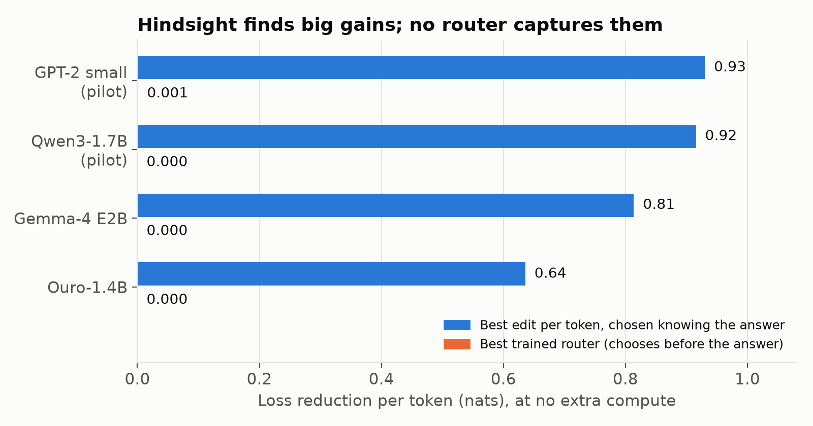
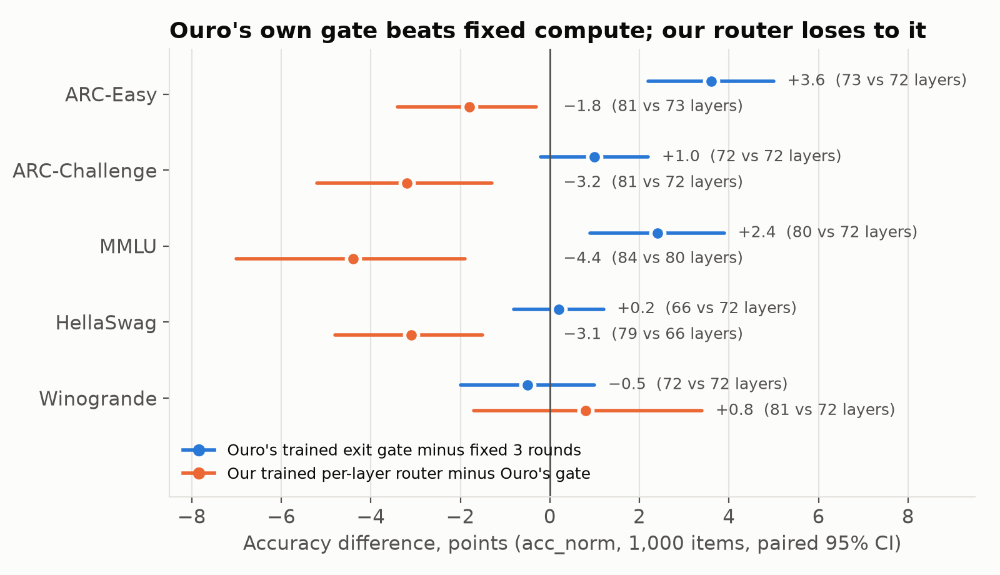
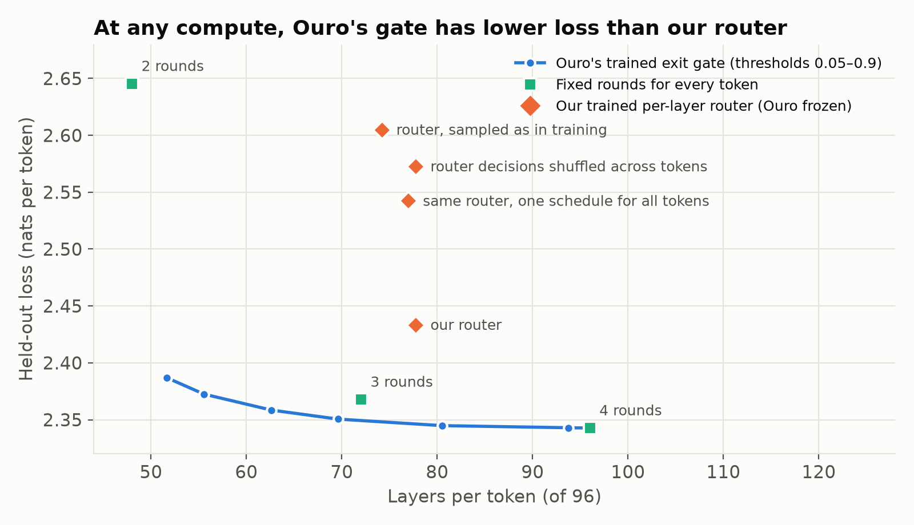
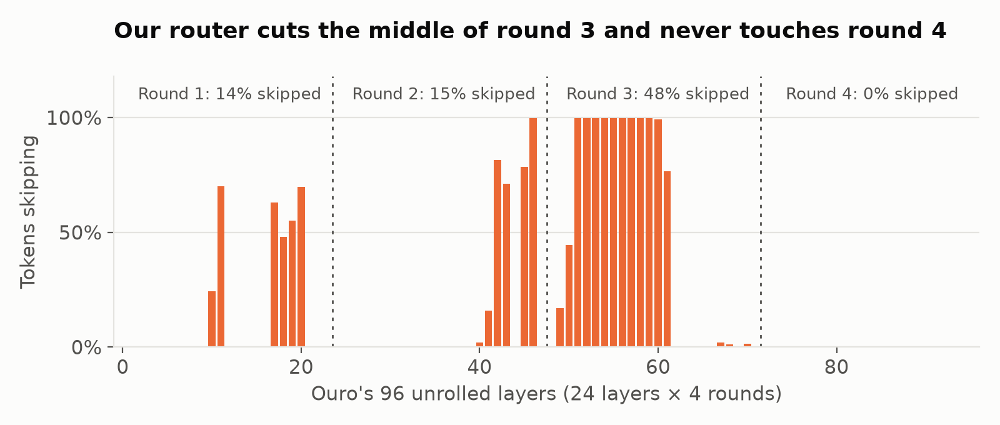

# Can a language model choose its own layers, token by token?

*Kāula research note, November 1, 2026. Code, data and every number below: [github.com/Kaula-AI/layer-looping](https://github.com/Kaula-AI/layer-looping).*

A transformer runs every token through the same fixed stack of layers. We wanted to know whether that has to be so. Could each token take its own path through the network: loop a layer three times, skip the next, revisit an earlier one? Hard tokens would get more depth and easy tokens less.

We tested this on four models, from GPT-2 to a model trained to loop. Benchmarks were scored with paired statistics.

## Summary

- **In hindsight, per-token paths look very powerful.** If you choose each token's layer edit after seeing the answer, the loss drops by 0.6 to 0.9 nats per token at no extra compute, on every model we tried.
- **No router could choose those paths in advance.** Linear and MLP routers, interpretability features, raw hidden states, confidence-based self-selection and training-free rules from prior work all failed to beat "no edit" when fitted to a frozen model. Most of the hindsight gain comes from picking the best of many small perturbations after seeing the answer.
- **Per-token compute does pay off when the router is trained with the model.** Ouro-1.4B was pretrained to loop and has a learned exit gate. That gate beats a fixed compute budget on ARC-Easy by +3.6 points at the same compute (paired p < 0.0001) and matches full-compute accuracy elsewhere with 14–33% fewer layers.
- **Our finer-grained router lost to that coarse gate.** We trained a per-layer router (skip, run once or run twice at each of Ouro's 96 unrolled layers) for about 10M tokens. It was worse than Ouro's built-in gate on 4 of 5 benchmarks while using more compute. A diagnostic shows why: it gives *less* compute to hard tokens, and per-layer decisions never discovered the cheapest saving, dropping the last round.

## The idea

Take a model's layers as a library. The standard path for a token is `0, 1, 2, …, L−1`. A per-token path might be

```
1 1 1 3 3 2 4 4 …   (layer 1 three times, skip 2, layer 3 twice, back to 2, layer 4 twice)
```

The cost of a path is the number of layer applications. The question is whether a cheap router can pick a good path for each token *before* the answer is known, at the same or lower compute.

## How we measured it

- **An exact per-token oracle.** For every token and every candidate edit (repeat layer ℓ ×2 or ×3, skip ℓ, swap ℓ and ℓ+1, loop a block, exit early) we computed the change in that token's next-token loss. The edited token sees the other tokens' normal-pass keys and values (K/V) plus its own updated K/V. For a causal model, that makes the token's own prediction exact. CPU tests check it against an independent recomputation for every edit type and for arbitrary paths.
- **Routers** were trained on held-out-by-chunk data to predict each edit's effect from the current or previous token's internals. We report the best result at matched compute, with 95% bootstrap confidence intervals.
- **Benchmarks:** ARC-Easy, ARC-Challenge, HellaSwag, MMLU and Winogrande. We used 1,000 items or the full set if smaller, scored like lm-eval-harness (`acc_norm`). Comparisons are paired on identical items, with a bootstrap CI and McNemar's test.

## Finding 1: the hindsight gain is large, and almost none of it is reachable



*Blue: loss reduction if each token gets its best single edit, chosen knowing the answer. Orange: the best trained router at zero extra compute. GPT-2 and Qwen3 are pilots that apply each edit to the whole sequence; Gemma-4 E2B and Ouro-1.4B use the exact per-token oracle.*

Three checks say the hindsight gain is mostly selection, not signal:

- **It isn't numerical noise.** Recomputing Gemma-4 E2B's oracle in float32 gives the same −0.81 nats as bf16 (per-edit correlation 0.9999).
- **It grows with the number of options.** With multi-edit paths the hindsight gain rises from −0.87 (single edits) to −0.97 (a shared path library) to −1.30 (per-token beam search). That's what picking the best of more lottery tickets looks like.
- **It sits almost entirely on tokens the model already gets wrong.** On Gemma-4 E2B, 0% of the most confident fifth of tokens are helped, versus 100% of the least confident three fifths.

Every router we tried scored at or below chance at identifying which tokens an edit would help (AUC 0.20–0.52, where 0.5 is chance). That covered ridge and MLP routers, routers reading the current or the previous token, logit-lens and attention features or raw residuals, training-free entropy and norm rules from prior work, and "try a few edits and keep the most confident output." Every one preferred no edit at all when held to the base model's compute.

## Finding 2: a standard model won't learn to use a loop from light fine-tuning

On Gemma-4 E2B we trained LoRA adapters with a looped block of layers 5–8. A learnable weight, starting at 0, mixed in the loop's output; we also tried a learned per-token gate. Training kept the mixing weight at |α| < 5×10⁻⁴, even with a 50× faster learning rate on it. The gate closed to 0.2%. Every looped variant landed within seed-to-seed noise of a LoRA control with no loop. Rerunning pretrained layers on their own output is out of distribution, and about 6M tokens of training didn't change that.

## Finding 3: a router trained with the model works

Ouro-1.4B (ByteDance) runs its 24 layers four times and was pretrained on 7.7T tokens with a per-token exit gate. Using that gate to stop each token early:



*Blue: Ouro's own gate (threshold 0.2) minus a fixed 3 rounds for every token. Orange: our trained per-layer router (Ouro's weights frozen) minus Ouro's gate. Numbers in parentheses are layers per answer token. Paired 95% CIs over 1,000 items.*

- **ARC-Easy:** the gate beats fixed 3 rounds by **+3.6 points [+2.2, +5.0], p < 0.0001**, at the same compute (73 vs 72 layers).
- **HellaSwag:** it matches fixed rounds while using 66 instead of 72 layers.
- **MMLU:** it gains +2.4 points, but uses 80 layers to the baseline's 72, so this one isn't matched compute.
- **Across all five tasks:** it stays within 0.1–0.4 points of full 96-layer accuracy.
- **A fifth round for every token adds nothing** on any task.

On held-out text, the gate at threshold 0.5 exits 54% of tokens early, saving 13 layers per token at a loss change of −0.002. Our frozen-model routers on the same model were worse than no edit (+0.057).

## Finding 4: finer control lost to coarse control

We then trained our own router with the model's loss. At every one of Ouro's 96 unrolled layers, a small head chooses skip, once or twice for each token. It was trained end to end with straight-through Gumbel-softmax and a compute budget of 72 layers per token.

- **Training had to be stabilised.** The first two attempts collapsed to 10–18 layers per token within 25 steps: one shared budget signal flips all 96 heads to "skip" at once. A two-sided quadratic penalty with an annealed target fixed it.
- **With LoRA:** the router matched the LoRA-only control's full-compute (96-layer) accuracy on MMLU and Winogrande at 23% less compute. But the 10M-token LoRA fine-tune itself cost 4 MMLU points, so the result is still behind the original Ouro with its gate.
- **With Ouro frozen (router only):** worse than Ouro's gate on 4 of 5 tasks (ARC-C −3.2, ARC-E −1.8, HellaSwag −3.1, MMLU −4.4, all p < 0.05). Winogrande was +0.8, not significant. It also used *more* layers at evaluation (79–84) than in training (74), because argmax decisions differ from the sampled ones it trained on.

## Finding 5: why our router lost

We ran the retrained router (held-out loss 2.417, matching the first run) against Ouro's gate on 32 held-out FineWeb-Edu chunks of 1,024 tokens.



*Held-out loss against layers per token. Blue: Ouro's gate at thresholds 0.05 to 0.9. Green: every token runs the same number of rounds. Orange: our router and three controls.*

- **It sits above even fixed compute.** At 78 layers per token its loss is 2.433. Running 3 rounds for every token (72 layers) gives 2.368, and Ouro's gate gives 2.351 at 70 layers.
- **It gives less compute to hard tokens.** Each token's layer count correlates *negatively* with how hard the token is for the base model (Spearman −0.23). Ouro's gate does the opposite (+0.42 at threshold 0.2).
- **It routes per token, a little.** 96% of its decisions match each layer's majority action. But replacing them with that one fixed schedule raises the loss from 2.433 to 2.542, and shuffling its decisions across tokens raises it to 2.573. The per-token signal is real; it just points the wrong way overall.
- **It never found the cheapest saving.**



*Share of tokens skipping each of Ouro's 96 unrolled layers.*

The 4th round is worth only 0.025 nats per token on average, so dropping it whole is the cheapest compute to give up, and that is what Ouro's gate does. Our router skips 0% of round 4 and instead removes the middle of round 3, which costs more. It also never chose "run twice". Our reading, not yet tested directly: a head deciding one layer at a time sees that skipping any *single* late layer hurts, and can't see that skipping all 24 of them together is nearly free. Independent per-layer decisions trained with straight-through gradients have no way to discover coordinated, multi-layer actions like "stop here."
- **Training and evaluation disagree.** With decisions sampled as in training, the router uses 74 layers at a loss of 2.605. With its most likely decisions (how it is benchmarked) it uses 78 layers at 2.433.

## What we take from this

1. **Per-token compute allocation is real, but it has to be learned jointly with the model.** Fitting a router to a frozen network finds nothing; a gate trained alongside the network finds benchmark-level gains.
2. **The useful granularity so far is coarse.** "How many rounds" beat "which layer, how many times," even though the second strictly contains the first. More options made the hindsight gain bigger and the learned policy worse: the per-layer router never discovered the coordinated "stop after round 3" that the gate gets for free.
3. **Hindsight oracles mislead here.** A per-token oracle over many edits measures how often *some* perturbation happens to favor the right token. Report it, but don't read it as reachable headroom.

## Open questions

- **Structured actions.** A router whose choices are whole spans ("stop after this round," "repeat this block") rather than single layers would see the cheap, coordinated savings that per-layer decisions miss.
- **Does any of this hold at larger scale?** The next target is a loop-converted Qwen3-8B (LoopUS, arXiv 2605.11011), whose built-in halting is decided per sequence rather than per token.

## Limitations

- **Small models:** 1.4B to 2B parameters for the main results. The 20k-token oracles are quick runs.
- **Small training budget:** our router trained on about 10M tokens; Ouro's gate trained over 7.7T.
- **Benchmark scoring:** each answer token follows its path against the other tokens' normal-pass K/V. That is exact for its own prediction, and it's the same accounting as Ouro's own early-exit evaluation, but it isn't a deployed decoding loop.
- **No wall-clock speedups.** Compute is counted in layer applications.

## Reproduce

All results are in `results/`; the experiment log is `EXPERIMENTS.md`.

```bash
python -m pytest -q tests                                               # 33 CPU exactness tests
python oracle.py --model ByteDance/Ouro-1.4B --n_tokens 20000 --out ouro_quick && python probe.py --path ouro_quick/oracle.npz --out_dir ouro_quick
python bench.py --model ByteDance/Ouro-1.4B --policies base rounds:3 gate:0.2 --out bench   # benchmarks
python routed_ouro.py --variant router --no_lora --target_layers 72 --out r5/router72_frozen  # our router
python bench_compare.py --dir bench ... --a gate:0.2 --b rounds:3 --metric acc_norm        # paired tests
python diagnose_router.py --ckpt r5/router72_frozen/model.pt --out diag                     # why the router lost
python scripts/make_findings_figs.py                                      # these figures
```
